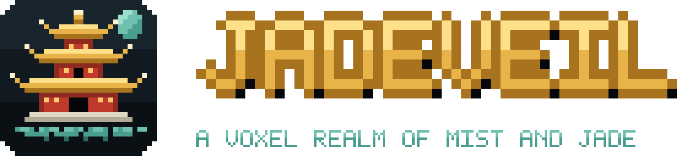
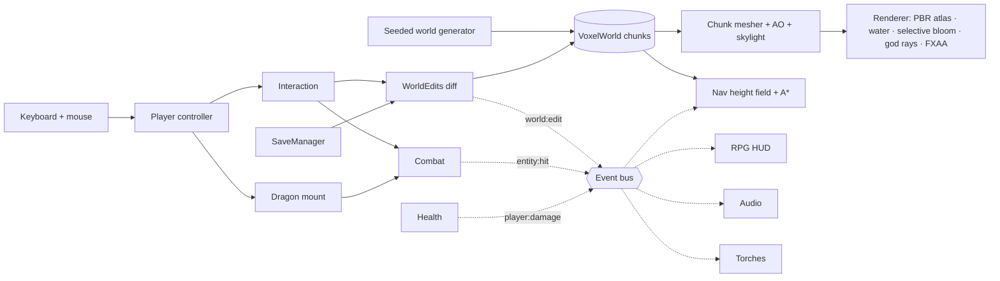

<p align="center">
  <strong>English</strong>&nbsp;&nbsp;·&nbsp;&nbsp;<a href="./README.zh-CN.md">简体中文</a>
</p>

<p align="center">
  <a href="https://jadeveil.xiaoa.name"></a>
</p>

<p align="center">
  A single-player RPG in the Minecraft render style, built from scratch on three.js — a Chinese voxel capital of mist and jade, a hero in a red hoodie, and an Ender Dragon you can ride.
</p>

<p align="center">
  <a href="https://jadeveil.xiaoa.name"><strong>▶ PLAY IN YOUR BROWSER</strong></a>
  &nbsp;·&nbsp;
  <a href="#play-and-install"><strong>Install as an app</strong></a>
</p>

<p align="center">
  <a href="#the-realm">The realm</a>
  &nbsp;·&nbsp;
  <a href="#gameplay-systems">Gameplay systems</a>
  &nbsp;·&nbsp;
  <a href="#architecture">Architecture</a>
  &nbsp;·&nbsp;
  <a href="#local-development">Local development</a>
  &nbsp;·&nbsp;
  <a href="#testing">Testing</a>
  &nbsp;·&nbsp;
  <a href="#rights--attribution">Rights &amp; attribution</a>
</p>

<p align="center">
  <a href="https://jadeveil.xiaoa.name"></a>
  
  
  
  
  
  
</p>

<p align="center">
  <a href="https://jadeveil.xiaoa.name"></a>
</p>

---

## The realm

JADEVEIL is a browser game that borrows Minecraft's look — blocky worlds, pixel textures, a 64 × 64 player skin — and points it at a different genre: a story-driven, single-player RPG in the spirit of an MMO capital city. The long-term target is *a Minecraft-rendered Guild Wars 2*; this repository is the foundation that makes that possible.

Everything is procedural and offline. All 200+ block textures are painted pixel by pixel in code, the world is generated deterministically from a fixed seed, and the game runs straight from ES modules — there is no bundler, no build step and no runtime network dependency.

<p align="center">
  
  <br><sub>The Ender Dragon mount — rebuilt part by part from the original model — breathing over the capital at dusk.</sub>
</p>

<table>
  <tr>
    <td width="50%" align="center"><br><sub>JJ — standard MC skin layout, two-layer hood, glowing Jade Blade</sub></td>
    <td width="50%" align="center"><br><sub>The lantern avenue — 140 residents on a body-aware navigation grid</sub></td>
  </tr>
  <tr>
    <td align="center"><br><sub>The training yard at night — torches, dummies and live health bars</sub></td>
    <td align="center"><br><sub>27 Chinese building materials, 6 randomized variants each</sub></td>
  </tr>
  <tr>
    <td align="center"><br><sub>Inventory and build catalog — Minecraft-style stack handling</sub></td>
    <td align="center"><br><sub>Title screen — continue, new game or load a save file</sub></td>
  </tr>
</table>

## Play and install

Play instantly at **[jadeveil.xiaoa.name](https://jadeveil.xiaoa.name)**. JADEVEIL is a Progressive Web App: install it once and it opens in its own window, launches from the dock or home screen, and keeps working offline.

| Platform | How to install |
|---|---|
| Chrome / Edge (desktop) | Click **INSTALL APP** on the title screen or pause menu, or use the install icon in the address bar |
| Android (Chrome) | **INSTALL APP** in the menu, or ⋮ → *Install app* |
| iPhone / iPad (Safari) | Share → *Add to Home Screen* (the title screen shows the hint) |

The game shell is precached at install time, and every module, texture and sound is cached the first time you play. After that the game boots fully offline. Saves live in the browser for each origin. To move progress between devices or domains, use **EXPORT SAVE FILE** and **LOAD SAVE FILE** in the pause menu.

## Highlights

<table>
  <tr>
    <td width="50%" valign="top">
      <h3>A faithful dragon, not a lookalike</h3>
      <p>The mount follows the original <code>EnderDragonModel</code> layout: part sizes, pivots, 256 × 256 box UVs, the two-segment wings and the original flap curves. Its eyes and breath use selective bloom, and it has four skills: breath, ender fireball, void dash and roar.</p>
    </td>
    <td width="50%" valign="top">
      <h3>Residents that never clip</h3>
      <p>NPCs walk a per-block height-field grid that tracks headroom and body radius. Every step is validated against the body footprint, so a resident cannot end up inside a wall, in water or in mid-air. A 90-second simulation of all 140 checks this continuously.</p>
    </td>
  </tr>
  <tr>
    <td valign="top">
      <h3>Saves measured in kilobytes</h3>
      <p>The world comes from a fixed seed, so a save stores only the blocks the player changed — keyed by block name with a palette — plus player, inventory and time. It autosaves to IndexedDB and can be exported or imported as a <code>.jadeveil</code> file.</p>
    </td>
    <td valign="top">
      <h3>Procedural pixel art</h3>
      <p>Every texture is generated at 64 × 64 with derived normal and roughness maps. Building materials are randomized per brick and per plank, and the atlas paints several re-seeded variants so large walls never repeat.</p>
    </td>
  </tr>
  <tr>
    <td valign="top">
      <h3>Lighting that respects the pixels</h3>
      <p>Bloom is selective, following the official three.js example, so only lanterns, gilded tiles, torch flames, the jade blade and dragon effects glow. God rays come from an occlusion mask, which avoids afterimages, and the water uses planar reflection with caustics.</p>
    </td>
    <td valign="top">
      <h3>A real game loop</h3>
      <p>The game has health, air, fall damage, regeneration and death. Melee has cooldowns and falling crits, broken blocks drop items you can pick up, and torches mount on floors and walls and fall off when their support is removed. Everything is wired through one event bus.</p>
    </td>
  </tr>
</table>

## Controls

| Action | Key |
|---|---|
| Move / sprint / jump | `W` `A` `S` `D` · `Shift` · `Space` |
| Attack target, or break the block under the crosshair | Left mouse |
| Place held block / mount torch on floor or wall | Right mouse |
| Select hotbar slot | `1`–`9` · mouse wheel |
| Inventory and build catalog | `E` |
| Summon / dismiss the Ender Dragon | `F` |
| Dragon skills: breath (hold) · fireball · void dash · roar | `1` `2` `3` `4` (left / right mouse also trigger breath / fireball) |
| Ascend / descend while mounted | `Space` · `Ctrl` or `C` |
| Camera: first person → third person → orbit | `V` |
| Time speed · head bob · settings · minimap · hide HUD | `T` · `B` · `O` · `M` · `H` |
| Debug overlay (stats, time of day, chunk progress) | `F3` |
| Pause menu: save, export, load, settings, title | `Esc` |

## Gameplay systems

| System | What it does | Source |
|---|---|---|
| Hero | JJ on the Minecraft 1.8+ 64 × 64 skin layout with a base layer and an inflated overlay; first-person arm with held items; swim, ride and swing poses | `src/player/skin.js`, `src/player/avatar.js` |
| Health | 20 HP, fall damage of blocks fallen minus 3, 10 s of air, regeneration after 6 s without damage, death and respawn | `src/game/health.js` |
| Inventory | 36 slots (hotbar + pack); take, split and shift-move stacks; a build catalog with every block | `src/game/inventory.js`, `src/ui/inventoryUI.js` |
| Building | Breaking spawns item drops that magnetize into the pack; placing consumes the held stack | `src/player/interaction.js`, `src/game/drops.js` |
| Items | Wooden, stone and jade swords (damage, cooldown, knockback, crits); torches with flame particles and pooled point lights | `src/game/items.js`, `src/game/sprites.js`, `src/game/torches.js` |
| Combat | Damageable registry, sphere / cone / ray queries, lingering damage zones, floating damage numbers | `src/game/combat.js`, `src/game/dummy.js` |
| Mount | Ender Dragon model, flight tuning, banking, energy, four skills, pixel-square VFX | `src/mount/` , `src/fx/fxParticles.js` |
| Residents | 10 roles on one atlas-skinned instanced rig; POIs, conversations, greetings, look-at, dragon sightings | `src/world/npc.js`, `src/world/navgrid.js` |
| Saves | IndexedDB autosave, title-screen continue, `.jadeveil` export and import, versioned migration | `src/game/save.js`, `src/game/worldEdits.js` |
| Interface | Pixel-font UI, title and pause menus, one aligned bottom HUD, viewport-aware scaling | `src/ui/` |

## Architecture



Systems talk through `src/game/events.js` (`domain:action` events) rather than calling one another. A new system subscribes to the events it cares about without changing the code that emits them.

### Frame order

```text
day/night → player physics → mount pose & skills → avatar pose
→ health · combat zones · drops · torches · autosave
→ chunk streaming & culling → light pool (lanterns + torches, nearest 8)
→ residents → particles → god-ray mask → bloom composer → main composer → HUD
```

### Resident movement guarantee

```text
supportHeight(x, z) = max standable height under the body footprint
bodyFits(x, z)      = every footprint sample is walkable, at most 1 below H,
                      and has ≥ 2 free blocks above H
every step          = bodyFits(candidate) || slide along one axis || stay
```

Path edges are pre-validated with the same predicate (cached per edge and invalidated when the world changes), so A* never plans a move that the movement code would refuse.

## Save format

```jsonc
{
  "game": "jadeveil",
  "version": 1,
  "savedAt": 1792240000000,
  "player": { "pos": [0.5, 35, 84.5], "yaw": 3.14, "pitch": -0.05, "mode": "first" },
  "health": { "hp": 20, "air": 10 },
  "inventory": { "selected": 0, "slots": [["sword_jade", 1], ["torch", 64], null] },
  "time": 420,
  "world": { "palette": ["jade_floor", "air"], "list": [2, 35, 82, 0] },
  "drops": [["block:oak_planks", 1, 3.5, 35.12, 81.5]]
}
```

## Repository map

```text
index.html                  # Page shell, HUD markup, import map → vendor/three, PWA & social meta
manifest.webmanifest        # PWA manifest (icons, screenshots, fullscreen display)
sw.js                       # Service worker: network-first with offline fallback
favicon.ico · favicon.svg   # Brand icons generated by scripts/brand.mjs
icons/ · pwa/               # App icons (any + maskable) and install-sheet screenshots
og-image.png                # 1200 × 630 social card
serve.mjs                   # Zero-dependency static dev server
src/
├── main.js                 # Boot, state machine, system wiring, test runner hooks
├── core/                   # Renderer, sky, day/night, water, ambient particles
├── world/                  # Voxel storage, generator, mesher, atlas, tiles, nav, residents
├── player/                 # Controller, avatar (JJ), skin rig, interaction
├── game/                   # Events, items, inventory, health, combat, drops, torches, saves
├── mount/                  # Ender Dragon model and mount controller
├── fx/                     # Pixel-square particle pool
├── audio/                  # Audio manager (CC0 / CC-BY sound effects)
└── ui/                     # Pixel font & UI kit, HUDs, menus, inventory, UI scaling
tests/                      # In-browser suites (collision, islands, world guard, water, quality, rpg, npc)
vendor/three/               # Pinned three.js r186 core + used addons
audio/                      # Sound effects + CREDITS.md
scripts/brand.mjs           # One 32 × 32 pixel logo → every icon, wordmark and social card
docs/                       # Art direction, development log, deployment notes, README assets
```

## Local development

### Requirements

- Node.js 18+ (only used to serve static files)
- A modern Chromium, Safari or Firefox with WebGL2

### Run

```bash
git clone https://github.com/a-side-project/jadeveil.git
cd jadeveil
node serve.mjs 8123
```

Open `http://127.0.0.1:8123/`. There is nothing to install or build — three.js is vendored and loaded through an import map. `npm install` is only needed for the deployment tooling.

## Testing

The suites run inside the live page against the real world, physics and systems, and they follow real input paths. A fall really falls, a dive really holds its breath, and a broken block is really walked over and picked up. Each suite runs in an isolated test state and restores the game afterwards.

```js
__pandaria.runCollisionTests()           // 34  sub-stepped AABB, tunnelling, chunk seams, flight
await __pandaria.runIslandAccessTests()  //  6  every floating island reachable on foot
__pandaria.runWorldGuardTests()          //  6  bedrock, void recovery, safe spawns
__pandaria.runWaterTests()               //  5  buoyancy, swimming, underwater view
__pandaria.runQualityTests()             //  3  avatar & placement regressions
__pandaria.runRpgTests()                 // 13  health, inventory, drops, building, torches, melee, mount, saves
__pandaria.runNpcTests()                 //  4  140 residents × 90 s: 0 in walls, 0 in water, 0 off-grid
```

## Deployment

The production build is a static deployment on Vercel, served at **[jadeveil.xiaoa.name](https://jadeveil.xiaoa.name)**. There is no install or build step (`vercel.json` declares both as no-ops). The service worker is served with `no-cache` so updates reach players immediately, and the security headers match the other `xiaoa.name` projects. Brand assets are regenerated with `node scripts/brand.mjs`.

## Engineering principles

- **Verify along the player's path.** Tests reproduce what a player does instead of teleporting to the answer.
- **Assert behavior, not bounds.** Assert "on the ground at exactly y = 126", not "not below 126".
- **Look at the pixels.** Rendering changes are checked against captured frames in every UI state and at several viewport sizes, not only against error counts.
- **Prefer the reference implementation.** Selective bloom follows the official three.js example and the dragon follows the original model, rather than threshold hacks or lookalikes.
- **Systems communicate through events.** Health, combat and world edits emit events; HUD, audio, torches and navigation subscribe.
- **State is data, the world is a function.** Saves contain only state; the world is regenerated from its seed.
- **No build step.** Plain ES modules, a pinned vendored three.js and an import map.

## Roadmap

- Crafting: a 2 × 2 grid in the pack, a crafting table and a recipe book
- Mobs, AI and loot; a GW2-style weapon skill bar
- Quests and dialogue with residents; merchants and an economy
- Equipment and armor slots

## Rights & attribution

This repository contains original source code, procedurally generated textures and documentation written for JADEVEIL.

- **JJ** is a character from Maizen's animated Minecraft series and appears here as a fan recreation. The skin is painted procedurally and no original assets are included.
- The **Ender Dragon** and the general look of **Minecraft** belong to Mojang Studios / Microsoft. The dragon's geometry is recreated from public knowledge of the model layout, and its texture is generated procedurally.
- The capital's art direction draws on public concept art of the Pandaria region from *World of Warcraft* (Blizzard Entertainment), cited in `docs/ART_DIRECTION.md`. No Blizzard assets or audio are included anywhere in the repository or its history.
- Sound effects are Kenney.nl (CC0) and Blender Foundation (CC-BY 3.0); see [`audio/CREDITS.md`](audio/CREDITS.md).
- three.js is © its authors and distributed under the MIT License (see `vendor/three/LICENSE`).

JADEVEIL is an independent, non-commercial project. It is not affiliated with or endorsed by Mojang, Microsoft, Maizen or Blizzard Entertainment. No license is granted for the original code at this time; all rights are reserved by the author. See [`THIRD_PARTY_NOTICES.md`](THIRD_PARTY_NOTICES.md).

---

<p align="center">
  <strong>JADEVEIL — A VOXEL REALM OF MIST AND JADE.</strong>
  <br><sub>One capital. One hero in a red hood. One very large dragon.</sub>
</p>
