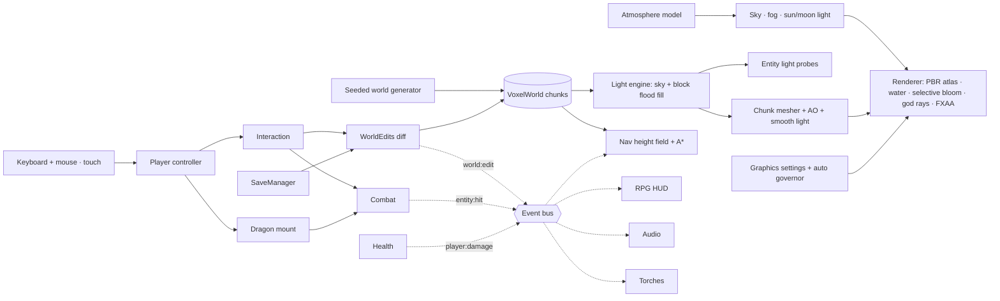

<p align="center">
  <strong>English</strong>&nbsp;&nbsp;·&nbsp;&nbsp;<a href="./README.zh-CN.md">简体中文</a>
</p>

<p align="center">
  <a href="https://jadeveil.xiaoa.name"></a>
</p>

<p align="center">
  A voxel fantasy realm in the Minecraft render style, built from scratch on three.js. Its first city — the Jade City, a capital of mist, crimson halls and floating jade islands — is open now: explore it as JJ in his red hood, build with Chinese materials, and fly over it on an Ender Dragon.
</p>

<p align="center">
  <a href="https://jadeveil.xiaoa.name"><strong>▶ PLAY IN YOUR BROWSER</strong></a>
  &nbsp;·&nbsp;
  <a href="#play-and-install"><strong>Install as an app</strong></a>
</p>

<p align="center">
  <a href="#the-realm">The realm</a>
  &nbsp;·&nbsp;
  <a href="#gameplay-systems">Gameplay systems</a>
  &nbsp;·&nbsp;
  <a href="#architecture">Architecture</a>
  &nbsp;·&nbsp;
  <a href="#local-development">Local development</a>
  &nbsp;·&nbsp;
  <a href="#testing">Testing</a>
  &nbsp;·&nbsp;
  <a href="#rights--attribution">Rights &amp; attribution</a>
</p>

<p align="center">
  <a href="https://jadeveil.xiaoa.name"></a>
  
  
  
  
  
  
  
</p>

<p align="center">
  <a href="https://jadeveil.xiaoa.name"></a>
</p>

---

## The realm

JADEVEIL is the name of a whole realm, not a single map. The long-term goal is a world on the scale of *Guild Wars 2* — many regions, cities and peoples tied together by one lore — rendered with Minecraft's look: blocky terrain, pixel textures and a 64 × 64 player skin. The genre is a story-driven single-player RPG rather than a sandbox.

Today one place exists: **the Jade City**, the first capital of the realm. Its art direction draws on the Pandaria region of *World of Warcraft* — crimson halls, gilded glazed roofs, lantern streets, terraced gardens and floating islands wrapped in mist. Everything in this repository is the foundation the rest of the realm will be built on: rendering, lighting, physics, residents, combat, saves and an interface that works on every device.

Everything is procedural and offline. All 200+ block textures are painted pixel by pixel in code, the world is generated deterministically from a fixed seed, and the game runs straight from ES modules — there is no bundler, no build step and no runtime network dependency.

<p align="center">
  
  <br><sub>The Ender Dragon mount — rebuilt part by part from the original model — breathing over the capital at dusk.</sub>
</p>

<table>
  <tr>
    <td width="50%" align="center"><br><sub>JJ — standard MC skin layout, two-layer hood, glowing Jade Blade</sub></td>
    <td width="50%" align="center"><br><sub>The lantern avenue — 140 residents on a body-aware navigation grid</sub></td>
  </tr>
  <tr>
    <td align="center"><br><sub>The training yard at night — torches, dummies and live health bars</sub></td>
    <td align="center"><br><sub>27 Chinese building materials, 6 randomized variants each</sub></td>
  </tr>
  <tr>
    <td align="center"><br><sub>Inventory and build catalog — Minecraft-style stack handling</sub></td>
    <td align="center"><br><sub>Title screen — continue, new game or load a save file</sub></td>
  </tr>
</table>

## Play and install

Play instantly at **[jadeveil.xiaoa.name](https://jadeveil.xiaoa.name)**. JADEVEIL is a Progressive Web App: install it once and it opens in its own window, launches from the dock or home screen, and keeps working offline.

| Platform | How to install |
|---|---|
| Chrome / Edge (desktop) | Click **INSTALL APP** on the title screen or pause menu, or use the install icon in the address bar |
| Android (Chrome) | **INSTALL APP** in the menu, or ⋮ → *Install app* |
| iPhone / iPad (Safari) | Share → *Add to Home Screen* (the title screen shows the hint) |

The game starts in fullscreen on browsers that support it (turn this off under **SETTINGS → GRAPHICS**). In fullscreen a short press of `Esc` opens the pause menu instead of leaving fullscreen. Phones and tablets play in landscape; holding a phone upright shows a rotate prompt and pauses the game.

The game shell is precached at install time, and every module, texture and sound is cached the first time you play. After that the game boots fully offline. Saves live in the browser for each origin. To move progress between devices or domains, use **EXPORT SAVE FILE** and **LOAD SAVE FILE** in the pause menu.

## Highlights

<table>
  <tr>
    <td width="50%" valign="top">
      <h3>A faithful dragon, not a lookalike</h3>
      <p>The mount follows the original <code>EnderDragonModel</code> layout: part sizes, pivots, 256 × 256 box UVs, the two-segment wings and the original flap curves. Its eyes and breath use selective bloom, and it has four skills: breath, ender fireball, void dash and roar.</p>
    </td>
    <td width="50%" valign="top">
      <h3>Residents that never clip</h3>
      <p>NPCs walk a per-block height-field grid that tracks headroom and body radius. Every step is validated against the body footprint, so a resident cannot end up inside a wall, in water or in mid-air. A 90-second simulation of all 140 checks this continuously.</p>
    </td>
  </tr>
  <tr>
    <td valign="top">
      <h3>Saves measured in kilobytes</h3>
      <p>The world comes from a fixed seed, so a save stores only the blocks the player changed — keyed by block name with a palette — plus player, inventory and time. It autosaves to IndexedDB and can be exported or imported as a <code>.jadeveil</code> file.</p>
    </td>
    <td valign="top">
      <h3>Procedural pixel art</h3>
      <p>Every texture is generated at 64 × 64 with derived normal and roughness maps. Building materials are randomized per brick and per plank, and the atlas paints several re-seeded variants so large walls never repeat.</p>
    </td>
  </tr>
  <tr>
    <td valign="top">
      <h3>Light that stays where it belongs</h3>
      <p>Lanterns and torches no longer use real-time point lights. Sky light and block light flood through the voxel world, one level per block, the way Minecraft lights a world. Walls stop the light, rooms and eaves darken step by step, and every vertex averages its four neighbours for smooth gradients. Edits relight incrementally and give exactly the same result as a full recompute. Players, residents and the dragon sample the same light field, so they darken indoors and glow under a lantern. The sun's shadow map is snapped to texels, so shadow edges do not shimmer while you walk.</p>
    </td>
    <td valign="top">
      <h3>A real game loop</h3>
      <p>The game has health, air, fall damage, regeneration and death. Melee has cooldowns and falling crits, broken blocks drop items you can pick up, and torches mount on floors and walls and fall off when their support is removed. Crouching keeps you from walking off ledges. Everything is wired through one event bus.</p>
    </td>
  </tr>
  <tr>
    <td valign="top">
      <h3>A sky computed, not painted</h3>
      <p>The sky is a single-scattering atmosphere with Rayleigh and Mie scattering and ozone absorption. The same model drives the fog, the ambient light and the sun's colour, so the horizon always matches the sky. Sunsets fade from gold to red to a violet afterglow. After dusk the moon takes over as the shadow-casting light. It has an eight-day cycle of phases with a correct terminator, and on a new-moon night the lanterns are the only light. The stars turn through the night.</p>
    </td>
    <td valign="top">
      <h3>Full quality on strong machines, smooth on weak ones</h3>
      <p>Five graphics settings are available: AUTO, LOW, MED, HIGH and ULTRA. Each one actually removes work — resolution, shadows, bloom, god rays, reflections, view distance and particles — instead of only hiding it. Passes that would contribute nothing are skipped every frame. AUTO starts from a GPU and device check, so high-end desktops run ULTRA, and it steps down one setting only after sustained low frame rates, telling the player where to change it. Once the slowdown passes, 20 seconds of headroom step it back up, never above the detected setting. On an Apple M3 Max, a frame costs 0.46 ms on LOW and 5.65 ms on ULTRA.</p>
    </td>
  </tr>
  <tr>
    <td valign="top">
      <h3>Built for touch, not adapted to it</h3>
      <p>On phones and tablets the game uses a floating analog stick: a light push walks and the edge sprints. Dragging on the right turns the camera and tapping attacks, and multi-touch works throughout. Jump, crouch, descend and the menus have their own buttons, placed within the device's safe areas. The interface keeps touch targets large on small screens.</p>
    </td>
    <td valign="top">
      <h3>A proper settings window</h3>
      <p>Settings open in a centred window with GRAPHICS, CONTROLS and AUDIO tabs. Every key is listed with how it works (HOLD, PRESS or CLICK), crouch and sprint can each be set to hold or toggle, and RESTORE DEFAULTS resets everything with a confirmation. The cursor is pixel art. Any open window releases the mouse, and closing it never leaves the game stuck without control.</p>
    </td>
  </tr>
  <tr>
    <td valign="top">
      <h3>Two ways to play, skills you learn by doing</h3>
      <p>ADVENTURE is the default: the Jade Blade is in hand and the left mouse button slashes. There are no classes, skill points or skill trees. You start with practical skills (lunge, whirling blade, mend, evade), and the Jade Crescent unlocks after 20 blade hits. BUILD is Minecraft: break, place and the full hotbar. <code>B</code> switches between them.</p>
    </td>
    <td valign="top">
      <h3>A world that reacts</h3>
      <p>Water flows with eight levels the way Minecraft water does: break a dam and the pond pours out, and cut off the source and the stream dries up. Sand falls and flowers drop when their soil is removed. The dragon's fireball blasts craters that throw solid debris, and its breath burns wood, leaves and bamboo. Terrain damage can be turned off in settings.</p>
    </td>
  </tr>
  <tr>
    <td valign="top">
      <h3>Frameworks that keep fixes fixed</h3>
      <p>A schedule table decides which systems run in each game state, so pausing freezes the world and the dead never autosave. One input router owns every key. Each mode of travel declares its own terrain rules, so the flying mount treats water as a floor. Structures claim their footprint during world generation, and a world audit (<code>npm test</code>) checks for overlaps, coplanar faces, floating blocks and unreachable stations. A seeded soak test drives a random player for 4,200 frames and checks eight invariants on every frame.</p>
    </td>
    <td valign="top">
      <h3>A skill wheel built for thumbs</h3>
      <p>On touch screens the skills sit on a wheel around the main attack button and change with the context: blade skills on foot, dragon skills when mounted, place in build mode. The wheel is laid out for the real screen, so buttons never overlap each other, the minimap or the screen edge, and each one shows its cooldown and learning progress.</p>
    </td>
  </tr>
</table>

## Controls

**Keyboard and mouse.** HOLD means the action lasts while the key is down; crouch and sprint can be switched to TOGGLE in **SETTINGS → CONTROLS**.

| Action | Key | How |
|---|---|---|
| Move | `W` `A` `S` `D` | hold |
| Sprint | `Shift` | hold (or toggle) |
| Crouch — slower, and you cannot walk off ledges | `C` | hold (or toggle) |
| Jump; hold to swim up or ascend | `Space` | press |
| Switch ADVENTURE ↔ BUILD | `B` | press |
| Adventure: Jade Slash | Left mouse · `1` | click |
| Adventure: lunge · whirling blade · crescent · mend | `2` `3` `4` `5` | press |
| Adventure: evade | `Q` | press |
| Build: attack target, or break the block under the crosshair | Left mouse | click |
| Build: place held block / mount torch on floor or wall | Right mouse | click |
| Build: select hotbar slot | `1`–`9` · mouse wheel | press |
| Inventory and build catalog | `E` | press |
| Summon / dismiss the Ender Dragon | `F` | press |
| Dragon breath (left mouse also works) | `1` while mounted | hold |
| Fireball · void dash · roar | `2` `3` `4` while mounted | press |
| Descend while flying or swimming | `C` | hold |
| Camera: first person → third person → orbit | `V` | press |
| Settings window | `O` | press |
| Time speed · minimap · hide HUD | `T` · `M` · `H` | press |
| Debug overlay (stats, time of day, chunk progress) | `F3` | press |
| Pause menu: save, export, load, settings, fullscreen, title | `Esc` | press |

**Touch (phones and tablets, landscape).**

| Action | Touch |
|---|---|
| Move — push to the edge to sprint | Left thumb anywhere on the left side (floating stick) |
| Look around | Drag on the right side |
| Attack / break block | Tap the right side |
| Adventure ↔ build | **BUILD** / **FIGHT** |
| Main action: slash · place · dragon breath | The large button at the bottom right (hold) |
| Skills | The wheel around the main button |
| Jump · swim up · ascend | **JUMP** (hold) |
| Crouch on / off | **CROUCH** |
| Descend while flying or swimming | **DOWN** (hold) |
| Select item | Tap a hotbar slot |
| Pause · inventory · dragon · camera | **MENU** · **BAG** · **DRAGON** · **VIEW** |
| Dragon skills | The wheel changes to dragon skills while mounted |

## Gameplay systems

| System | What it does | Source |
|---|---|---|
| Hero | JJ on the Minecraft 1.8+ 64 × 64 skin layout with a base layer and an inflated overlay; first-person arm with held items; swim, ride and swing poses | `src/player/skin.js`, `src/player/avatar.js` |
| Health | 20 HP, fall damage of blocks fallen minus 3, 10 s of air, regeneration after 6 s without damage, death and respawn | `src/game/health.js` |
| Inventory | 36 slots (hotbar + pack); take, split and shift-move stacks; a build catalog with every block | `src/game/inventory.js`, `src/ui/inventoryUI.js` |
| Building | Breaking spawns item drops that magnetize into the pack; placing consumes the held stack | `src/player/interaction.js`, `src/game/drops.js` |
| Items | Wooden, stone and jade swords (damage, cooldown, knockback, crits); torches with flame particles that emit block light | `src/game/items.js`, `src/game/sprites.js`, `src/game/torches.js` |
| Combat | Damageable registry, sphere / cone / ray queries, lingering damage zones, floating damage numbers | `src/game/combat.js`, `src/game/dummy.js` |
| Skills | Class-less blade skills learned by use; cooldowns, forced movement for lunge and evade; ADVENTURE / BUILD modes | `src/game/skills.js`, `src/ui/skillIcons.js` |
| Block physics | Eight-level flowing water, falling sand, plants that need support; batched ticks | `src/world/blockPhysics.js` |
| Destruction | Explosion craters with solid debris, burning, batched relight; can be switched off | `src/game/destruction.js` |
| Mount | Ender Dragon model, flight tuning, banking, energy, four skills, pixel-square VFX | `src/mount/` , `src/fx/fxParticles.js` |
| Residents | 10 roles on one atlas-skinned instanced rig; POIs, conversations, greetings, look-at, dragon sightings | `src/world/npc.js`, `src/world/navgrid.js` |
| Saves | IndexedDB autosave, title-screen continue, `.jadeveil` export and import, versioned migration | `src/game/save.js`, `src/game/worldEdits.js` |
| Interface | Pixel-font UI and pixel cursor; title and pause menus; a tabbed settings window with restore defaults; one aligned bottom HUD; viewport-aware scaling with touch minimums | `src/ui/` |
| Lighting | Sky light + block light flood fill (0–15 per block), smooth per-vertex lighting, incremental relight on edits, light probes for entities | `src/world/lighting.js`, `src/core/entityLight.js` |
| Day & night | Rayleigh / Mie / ozone atmosphere shared by sky, fog and lights; sun → moon key light; eight-day lunar phases; rotating stars; twilight adaptation | `src/core/atmosphere.js`, `src/core/sky.js`, `src/core/daynight.js` |
| Graphics | Five settings, a device check, an auto governor, per-frame pass skipping and particle density | `src/core/quality.js`, `src/core/renderer.js` |
| Devices | Touch controls with an analog stick and a context skill wheel, a rotate-to-landscape guard, fullscreen with keyboard lock, a ghost-click guard | `src/ui/touchControls.js`, `src/ui/rotateGuard.js`, `src/ui/fullscreen.js` |
| Frameworks | Per-state system schedule, one input router, per-mode terrain rules, generator footprint claims | `src/core/schedule.js`, `src/core/input.js`, `src/player/controller.js`, `src/world/generator.js` |

## Architecture



Systems talk through `src/game/events.js` (`domain:action` events) rather than calling one another. A new system subscribes to the events it cares about without changing the code that emits them.

### Frame order

```text
day/night (atmosphere-derived colours) → player physics → mount pose & skills → avatar pose
→ health · combat zones · drops · torches · autosave
→ chunk streaming & culling (light-only remeshes spread over frames) → entity light probes
→ residents → particles → [reflection if water is visible] → [god-ray mask if the sun is on screen]
→ [bloom composer] → main composer → HUD · touch layer · auto governor
```

### Lighting

```text
light(x, y, z) = sky << 4 | block                       (each 0..15)
sky   : 15 straight down through air; −1 per block sideways; leaves / water cost more
block : lanterns 15, torches 14; −1 per block; opaque blocks stop it
vertex: average of the 4 cells the corner touches (same cells as AO)
shade : albedo × mix(0.36, 1, sky^1.5)  +  albedo × warm × block^1.35 × day/night strength
edit  : remove-flood the old light, re-flood from the boundary, remesh only the chunks that changed
```

### Resident movement guarantee

```text
supportHeight(x, z) = max standable height under the body footprint
bodyFits(x, z)      = every footprint sample is walkable, at most 1 below H,
                      and has ≥ 2 free blocks above H
every step          = bodyFits(candidate) || slide along one axis || stay
```

Path edges are pre-validated with the same predicate (cached per edge and invalidated when the world changes), so A* never plans a move that the movement code would refuse.

## Save format

```jsonc
{
  "game": "jadeveil",
  "version": 1,
  "savedAt": 1792240000000,
  "player": { "pos": [0.5, 35, 84.5], "yaw": 3.14, "pitch": -0.05, "mode": "first" },
  "health": { "hp": 20, "air": 10 },
  "inventory": { "selected": 0, "slots": [["sword_jade", 1], ["torch", 64], null] },
  "time": 420,
  "world": { "palette": ["jade_floor", "air"], "list": [2, 35, 82, 0] },
  "drops": [["block:oak_planks", 1, 3.5, 35.12, 81.5]]
}
```

## Repository map

```text
index.html                  # Page shell, HUD markup, import map → vendor/three, PWA & social meta
manifest.webmanifest        # PWA manifest (icons, screenshots, fullscreen display)
sw.js                       # Service worker: network-first with offline fallback
favicon.ico · favicon.svg   # Brand icons generated by scripts/brand.mjs
icons/ · pwa/               # App icons (any + maskable) and install-sheet screenshots
og-image.png                # 1200 × 630 social card
serve.mjs                   # Zero-dependency static dev server
src/
├── main.js                 # Boot, state machine, system wiring, test runner hooks
├── core/                   # Renderer, atmosphere, sky, day/night, graphics settings, entity light, water, particles
├── world/                  # Voxel storage, generator, light engine, mesher, atlas, tiles, nav, residents
├── player/                 # Controller, avatar (JJ), skin rig, interaction
├── game/                   # Events, items, inventory, health, combat, skills, destruction, drops, torches, saves
├── mount/                  # Ender Dragon model and mount controller
├── fx/                     # Pixel-square particle pool
├── audio/                  # Audio manager (CC0 / CC-BY sound effects)
└── ui/                     # Pixel font & UI kit, HUDs, menus, settings, inventory, touch, fullscreen, UI scaling
tests/                      # In-browser suites (collision, islands, world guard, water, quality, rpg, npc, ux, world, soak)
scripts/audit-world.mjs     # World audit in Node (npm test)
vendor/three/               # Pinned three.js r186 core + used addons
audio/                      # Sound effects + CREDITS.md
scripts/brand.mjs           # One 32 × 32 pixel logo → every icon, wordmark and social card
docs/                       # Art direction, development log, deployment notes, README assets
```

## Local development

### Requirements

- Node.js 18+ (only used to serve static files)
- A modern Chromium, Safari or Firefox with WebGL2

### Run

```bash
git clone https://github.com/a-side-project/jadeveil.git
cd jadeveil
node serve.mjs 8123
```

Open `http://127.0.0.1:8123/`. There is nothing to install or build — three.js is vendored and loaded through an import map. `npm install` is only needed for the deployment tooling.

## Testing

The suites run inside the live page against the real world, physics and systems, and they follow real input paths. A fall really falls, a dive really holds its breath, and a broken block is really walked over and picked up. Each suite runs in an isolated test state. Afterwards it restores every block it changed, recorded by a write journal on the voxel store, along with the player's position, health, inventory, skills, mode and the time of day.

```js
await __pandaria.runAllTests()           // every suite below, plus a leak check between suites:
                                         // any suite that leaves a trace is reported by suite and field
__pandaria.runCollisionTests()           // 34  sub-stepped AABB, tunnelling, chunk seams, flight
await __pandaria.runIslandAccessTests()  //  6  every floating island reachable on foot
__pandaria.runWorldGuardTests()          //  6  bedrock, void recovery, safe spawns
__pandaria.runWaterTests()               //  5  buoyancy, swimming, underwater view
__pandaria.runQualityTests()             //  3  avatar & placement regressions
__pandaria.runRpgTests()                 // 13  health, inventory, drops, building, torches, melee, mount, saves
__pandaria.runNpcTests()                 //  4  140 residents × 90 s: 0 in walls, 0 in water, 0 off-grid
await __pandaria.runUxTests()            // 14  light blocked by walls, incremental = full relight, shadow texel snap,
                                         //     quality tiers, auto governor down and back up, crouch at ledges,
                                         //     toggle sprint, analog stick, settings never strand the pointer,
                                         //     restore defaults
await __pandaria.runWorldTests()         // 14  water spreads, dams break, streams dry up, sand falls, craters,
                                         //     burning, terrain-damage off, blade skills, learning, modes
await __pandaria.runSoakTests()          //  8  seeded random player × 4,200 frames, invariants checked every frame:
                                         //     finite state, never inside a block, mount never in water,
                                         //     pause freezes everything, HP in range, NPCs out of walls, no errors
```

The world itself is checked in Node, without a browser: `npm test` (or `npm run audit`) generates the world and checks seven rules — structure overlaps, plants inside structures, solid clouds in the city, coplanar transparent faces, floating structures, the wall enclosing the city, and every resident station being reachable.

Add `?quality=low|medium|high|ultra`, `?touch=1` or `?nosw` to the URL to force a graphics setting, force touch mode or bypass the service worker while testing.

## Deployment

The production build is a static deployment on Vercel, served at **[jadeveil.xiaoa.name](https://jadeveil.xiaoa.name)**. There is no install or build step (`vercel.json` declares both as no-ops). The service worker is served with `no-cache` so updates reach players immediately, and the security headers match the other `xiaoa.name` projects. Brand assets are regenerated with `node scripts/brand.mjs`.

## Engineering principles

- **Verify along the player's path.** Tests reproduce what a player does instead of teleporting to the answer.
- **Assert behavior, not bounds.** Assert "on the ground at exactly y = 126", not "not below 126".
- **Look at the pixels.** Rendering changes are checked against captured frames in every UI state and at several viewport sizes, not only against error counts.
- **Prefer the reference implementation.** Selective bloom follows the official three.js example and the dragon follows the original model, rather than threshold hacks or lookalikes.
- **Systems communicate through events.** Health, combat and world edits emit events; HUD, audio, torches and navigation subscribe.
- **State is data, the world is a function.** Saves contain only state; the world is regenerated from its seed.
- **No build step.** Plain ES modules, a pinned vendored three.js and an import map.

## Roadmap

- More of the realm: new regions and cities beyond the Jade City, travelled by dragon
- Crafting: a 2 × 2 grid in the pack, a crafting table and a recipe book
- Mobs, AI and loot; more weapons, each with its own learnable skills
- Quests and dialogue with residents; merchants and an economy
- Equipment and armor slots

## Rights & attribution

This repository contains original source code, procedurally generated textures and documentation written for JADEVEIL.

- **JJ** is a character from Maizen's animated Minecraft series and appears here as a fan recreation. The skin is painted procedurally and no original assets are included.
- The **Ender Dragon** and the general look of **Minecraft** belong to Mojang Studios / Microsoft. The dragon's geometry is recreated from public knowledge of the model layout, and its texture is generated procedurally.
- The capital's art direction draws on public concept art of the Pandaria region from *World of Warcraft* (Blizzard Entertainment), cited in `docs/ART_DIRECTION.md`. No Blizzard assets or audio are included anywhere in the repository or its history.
- Sound effects are Kenney.nl (CC0) and Blender Foundation (CC-BY 3.0); see [`audio/CREDITS.md`](audio/CREDITS.md).
- three.js is © its authors and distributed under the MIT License (see `vendor/three/LICENSE`).

JADEVEIL is an independent, non-commercial project. It is not affiliated with or endorsed by Mojang, Microsoft, Maizen or Blizzard Entertainment. No license is granted for the original code at this time; all rights are reserved by the author. See [`THIRD_PARTY_NOTICES.md`](THIRD_PARTY_NOTICES.md).

---

<p align="center">
  <strong>JADEVEIL — A VOXEL REALM OF MIST AND JADE.</strong>
  <br><sub>The first city of a larger realm. One hero in a red hood. One very large dragon.</sub>
</p>
