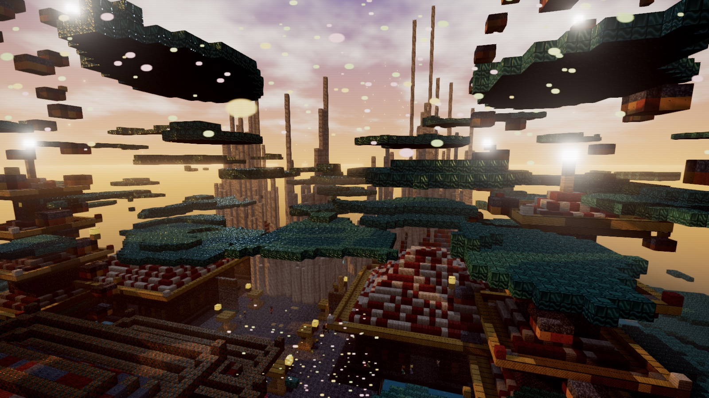
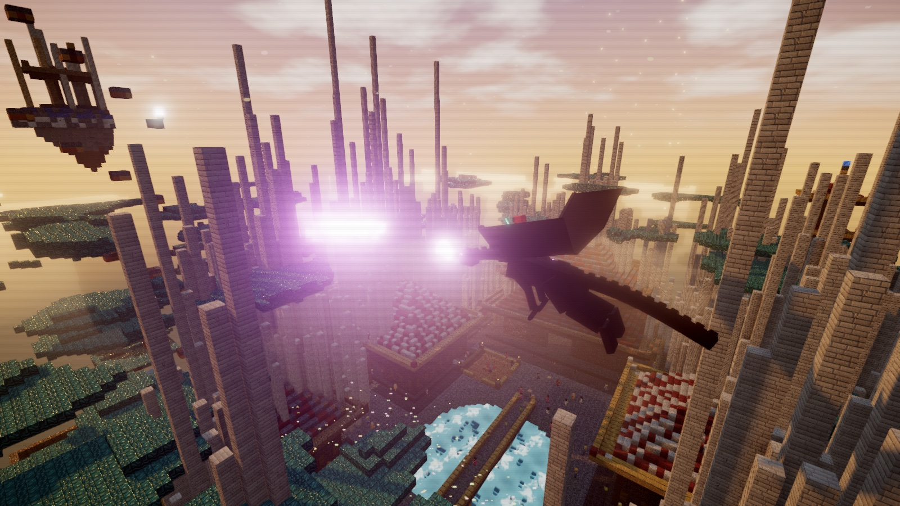
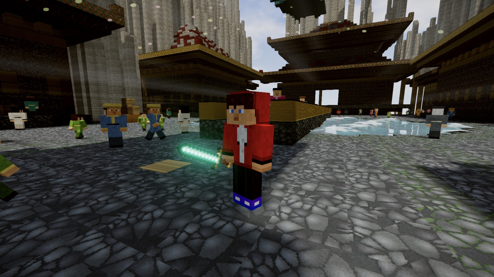
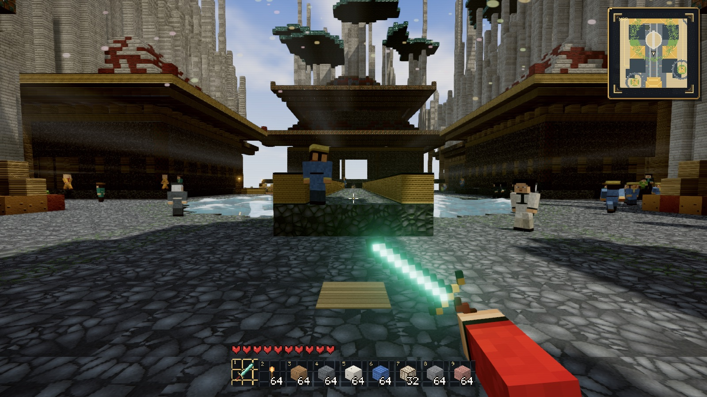
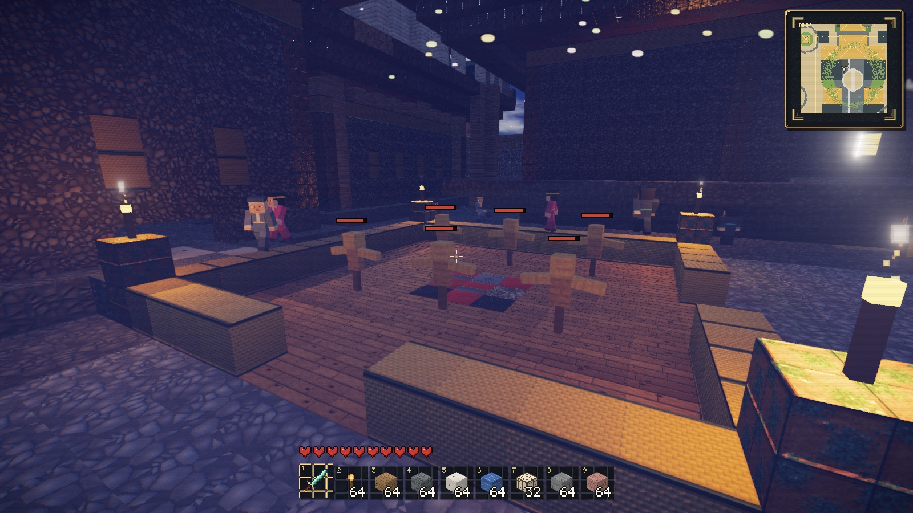
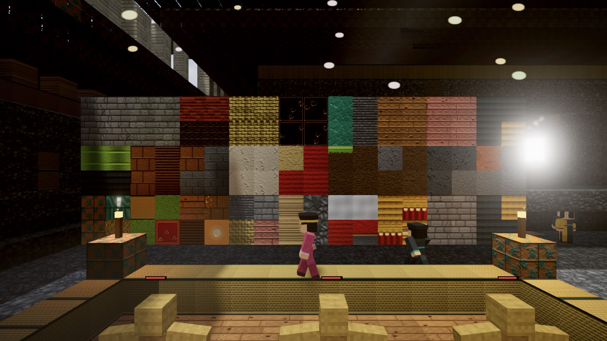
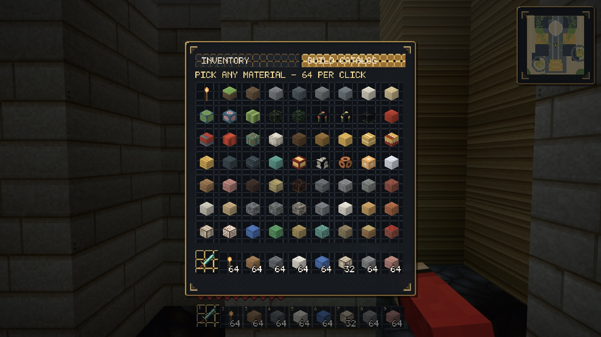
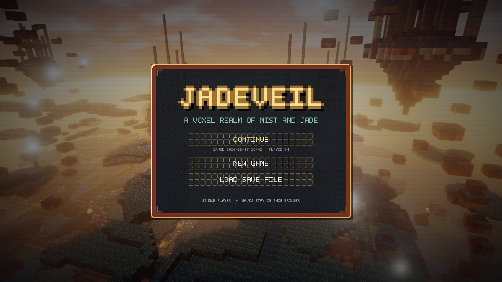
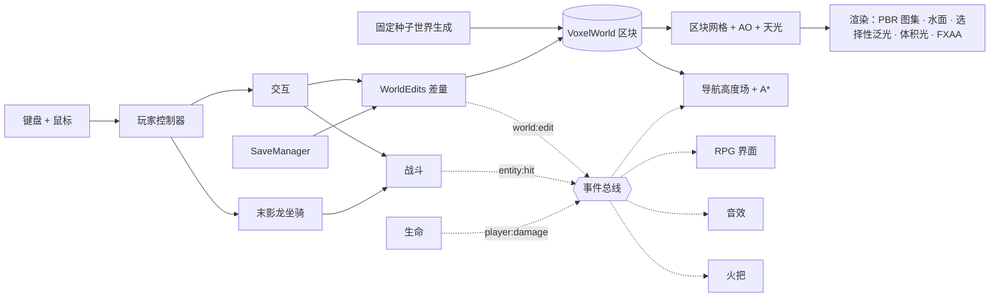

<p align="center">
  <a href="./README.md">English</a>&nbsp;&nbsp;·&nbsp;&nbsp;<strong>简体中文</strong>
</p>

<p align="center">
  
</p>

<h1 align="center">JADEVEIL</h1>

<p align="center">
  一款用 three.js 从零写成的 Minecraft 渲染风格单机 RPG —— 一座雾与玉的中式体素主城，一位穿红色连帽衫的主角，还有一条可以骑乘的末影龙。
</p>

<p align="center">
  <a href="#主城"><strong>主城</strong></a>
  &nbsp;·&nbsp;
  <a href="#玩法系统">玩法系统</a>
  &nbsp;·&nbsp;
  <a href="#架构">架构</a>
  &nbsp;·&nbsp;
  <a href="#本地运行">本地运行</a>
  &nbsp;·&nbsp;
  <a href="#测试">测试</a>
  &nbsp;·&nbsp;
  <a href="#版权与致谢">版权与致谢</a>
</p>

<p align="center">
  
  
  
  
  
</p>

---

## 主城

JADEVEIL 借用了 Minecraft 的外观：方块世界、像素贴图和 64 × 64 的角色皮肤。但它要做的是另一种游戏：一款叙事驱动的单机 RPG，气质上接近网游里的主城。长远目标是**一款 Minecraft 画风的《激战 2》**，这个仓库就是为此打下的地基。

一切都是程序化生成、离线可玩的。200 多张方块贴图全部由代码逐像素绘制，世界由固定种子确定性生成，游戏直接以 ES 模块运行：没有打包器，没有构建步骤，运行时也不依赖任何网络请求。

<p align="center">
  
  <br><sub>末影龙坐骑：按原版模型逐部件重建，黄昏时在主城上空喷吐龙息。</sub>
</p>

<table>
  <tr>
    <td width="50%" align="center"><br><sub>杰杰：MC 标准皮肤布局、双层兜帽、发光的玉剑</sub></td>
    <td width="50%" align="center"><br><sub>灯笼长街：140 位居民行走在考虑身体尺寸的导航网格上</sub></td>
  </tr>
  <tr>
    <td align="center"><br><sub>夜晚的训练场：火把、训练假人与实时血条</sub></td>
    <td align="center"><br><sub>27 种中式建材，每种 6 张随机变体</sub></td>
  </tr>
  <tr>
    <td align="center"><br><sub>背包与建材目录：Minecraft 式的堆叠操作</sub></td>
    <td align="center"><br><sub>标题页：继续游戏、新游戏或读取存档文件</sub></td>
  </tr>
</table>

## 亮点

<table>
  <tr>
    <td width="50%" valign="top">
      <h3>还原的是末影龙本身</h3>
      <p>坐骑严格按原版 <code>EnderDragonModel</code> 搭建：部件尺寸、枢轴、256 × 256 box UV、两段式翅膀和原版扇翼曲线都一致。龙眼与龙息走选择性泛光。四个技能：龙息、末影火球、虚空冲刺、龙吼。</p>
    </td>
    <td width="50%" valign="top">
      <h3>居民不会穿模</h3>
      <p>居民在逐格高度场导航网格上行走，网格记录每格的头顶净空和身体半径。每一步位移都要按身体占地校验，所以居民不可能走进墙里、水里或悬在半空。测试会让 140 人连续跑 90 秒，全程检查这三项。</p>
    </td>
  </tr>
  <tr>
    <td valign="top">
      <h3>存档只有几 KB</h3>
      <p>世界由固定种子生成，存档只记录玩家改动过的方块，以「方块名 + 调色板」保存，再加上玩家、背包和时间。存档自动写入 IndexedDB，也可以导出、导入 <code>.jadeveil</code> 文件。</p>
    </td>
    <td valign="top">
      <h3>程序化像素美术</h3>
      <p>所有贴图都以 64 × 64 生成，并派生出法线和粗糙度贴图。建材按每块砖、每条木板单独随机，图集还会换种子重绘出多张变体，大面积的墙面也不会重复。</p>
    </td>
  </tr>
  <tr>
    <td valign="top">
      <h3>尊重像素的光影</h3>
      <p>泛光按 three.js 官方示例做成选择性泛光，只有灯笼、琉璃瓦、火苗、玉剑和龙的特效会发光。体积光取自遮挡遮罩，不会产生残影。水面使用平面反射，并带焦散。</p>
    </td>
    <td valign="top">
      <h3>真正的游戏循环</h3>
      <p>有血量、氧气、摔落伤害、自然回血和死亡。近战带冷却和下落暴击；挖下的方块会掉落，走过去就能捡起；火把可以插在地面或墙面，支撑方块被挖掉时会掉下来。所有系统都通过同一条事件总线连接。</p>
    </td>
  </tr>
</table>

## 操作

| 动作 | 按键 |
|---|---|
| 移动 / 疾跑 / 跳跃 | `W` `A` `S` `D` · `Shift` · `空格` |
| 攻击目标；没有目标时挖掉准星下的方块 | 鼠标左键 |
| 放置手持方块 / 在地面或墙面插火把 | 鼠标右键 |
| 选择快捷栏 | `1`–`9` · 鼠标滚轮 |
| 背包与建材目录 | `E` |
| 召唤 / 解散末影龙 | `F` |
| 龙技能：龙息（按住）· 火球 · 虚空冲刺 · 龙吼 | `1` `2` `3` `4`（鼠标左 / 右键同样触发龙息 / 火球） |
| 骑乘时上升 / 下降 | `空格` · `Ctrl` 或 `C` |
| 视角：第一人称 → 第三人称 → 环绕 | `V` |
| 时间流速 · 头部摆动 · 设置 · 小地图 · 隐藏界面 | `T` · `B` · `O` · `M` · `H` |
| 调试信息（统计、时间、区块进度） | `F3` |
| 暂停菜单：保存、导出、读取、设置、回到标题 | `Esc` |

## 玩法系统

| 系统 | 做了什么 | 源码 |
|---|---|---|
| 主角 | 杰杰，使用 Minecraft 1.8+ 的 64 × 64 皮肤布局（底层 + 外层）；第一人称手臂和手持物；游泳、骑乘、挥击姿态 | `src/player/skin.js`、`src/player/avatar.js` |
| 生命 | 20 点血；摔落伤害 = 下落格数 - 3；10 秒氧气；脱离伤害 6 秒后回血；死亡与重生 | `src/game/health.js` |
| 背包 | 36 格（快捷栏 + 背包）；拿起、拆半、Shift 快速转移；收录全部方块的建材目录 | `src/game/inventory.js`、`src/ui/inventoryUI.js` |
| 建造 | 挖方块弹出掉落物，靠近自动吸入背包；放置会消耗手持的那一组 | `src/player/interaction.js`、`src/game/drops.js` |
| 道具 | 木剑、石剑、玉剑（伤害、冷却、击退、暴击）；火把（火苗粒子、共享点光源池） | `src/game/items.js`、`src/game/sprites.js`、`src/game/torches.js` |
| 战斗 | 可受伤实体注册表；球形、锥形、射线范围查询；持续伤害区；飘字伤害数字 | `src/game/combat.js`、`src/game/dummy.js` |
| 坐骑 | 末影龙模型、飞行手感、转向滚转、能量、四个技能、像素方块粒子特效 | `src/mount/`、`src/fx/fxParticles.js` |
| 居民 | 10 种职业共用一套图集皮肤和实例化骨架；兴趣点、聊天、打招呼、注视玩家、看见龙会惊呼 | `src/world/npc.js`、`src/world/navgrid.js` |
| 存档 | IndexedDB 自动存档；标题页继续游戏；导出和导入 `.jadeveil`；带版本号的迁移 | `src/game/save.js`、`src/game/worldEdits.js` |
| 界面 | 像素字体 UI；标题页和暂停菜单；整齐对齐的底部状态栏；按视口自适应缩放 | `src/ui/` |

## 架构



系统之间通过 `src/game/events.js` 的 `领域:动作` 事件通信，而不是互相直接调用。新系统只需订阅它关心的事件，不用修改发出事件的代码。

### 每帧顺序

```text
昼夜 → 玩家物理 → 坐骑姿态与技能 → 化身姿态
→ 生命 · 战斗区域 · 掉落物 · 火把 · 自动存档
→ 区块流式加载与剔除 → 点光源池（灯笼 + 火把，取最近 8 个）
→ 居民 → 粒子 → 体积光遮罩 → 泛光合成 → 主合成 → 界面
```

### 居民的移动保证

```text
supportHeight(x, z) = 身体占地下各采样点可站立面的最高值 H
bodyFits(x, z)      = 每个采样点都可走、比 H 低不超过 1 格，
                      且在 H 之上至少有 2 格净空
每一步位移           = bodyFits(候选位置) || 沿单轴滑行 || 原地不动
```

路径的每一条边都用同一个判定预先校验（按边缓存，世界改动时失效），所以 A* 永远不会规划出移动代码会拒绝执行的路线。

## 存档格式

```jsonc
{
  "game": "jadeveil",
  "version": 1,
  "savedAt": 1792240000000,
  "player": { "pos": [0.5, 35, 84.5], "yaw": 3.14, "pitch": -0.05, "mode": "first" },
  "health": { "hp": 20, "air": 10 },
  "inventory": { "selected": 0, "slots": [["sword_jade", 1], ["torch", 64], null] },
  "time": 420,
  "world": { "palette": ["jade_floor", "air"], "list": [2, 35, 82, 0] },
  "drops": [["block:oak_planks", 1, 3.5, 35.12, 81.5]]
}
```

## 目录结构

```text
index.html                  # 页面骨架、HUD 结构、import map → vendor/three
serve.mjs                   # 零依赖的本地静态服务器
src/
├── main.js                 # 启动、状态机、系统组装、测试运行器入口
├── core/                   # 渲染器、天空、昼夜、水面、环境粒子
├── world/                  # 体素存储、世界生成、网格、图集、贴图、导航、居民
├── player/                 # 控制器、化身（杰杰）、皮肤骨架、交互
├── game/                   # 事件、物品、背包、生命、战斗、掉落、火把、存档
├── mount/                  # 末影龙模型与坐骑控制
├── fx/                     # 像素方块粒子池
├── audio/                  # 音效管理（CC0 / CC-BY 音效）
└── ui/                     # 像素字体与 UI 套件、HUD、菜单、背包、界面缩放
tests/                      # 浏览器内测试套件（碰撞、浮岛、世界防护、水体、质量、RPG、居民）
vendor/three/               # 锁定版本的 three.js r186 核心与用到的 addons
audio/                      # 音效文件与 CREDITS.md
docs/                       # 美术方向、开发日志、部署说明、README 配图
```

## 本地运行

### 环境要求

- Node.js 18+（只用来提供静态文件）
- 支持 WebGL2 的现代 Chromium、Safari 或 Firefox

### 运行

```bash
git clone https://github.com/a-side-project/jadeveil.git
cd jadeveil
node serve.mjs 8123
```

打开 `http://127.0.0.1:8123/` 即可。不需要安装或构建任何东西：three.js 已随仓库提供，通过 import map 加载。只有部署工具需要 `npm install`。

## 测试

测试套件直接在运行中的页面里执行，作用于真实的世界、物理和各个系统，并且走的是玩家真实的操作路径：摔落是真的从高处掉下来，憋气是真的潜进水里，捡东西是真的挖下方块再走过去。每个套件都在隔离的测试状态下运行，结束后恢复游戏现场。

```js
__pandaria.runCollisionTests()           // 34  子步进 AABB、防隧穿、区块接缝、飞行
await __pandaria.runIslandAccessTests()  //  6  每座浮岛都能步行登上
__pandaria.runWorldGuardTests()          //  6  基岩、掉出世界恢复、安全出生点
__pandaria.runWaterTests()               //  5  浮力、游泳、水下视角
__pandaria.runQualityTests()             //  3  化身与放置回归
__pandaria.runRpgTests()                 // 13  生命、背包、掉落、建造、火把、近战、坐骑、存档
__pandaria.runNpcTests()                 //  4  140 人 × 90 秒：0 穿墙、0 入水、0 离网
```

## 工程原则

- **沿玩家的真实路径验证。** 测试复现玩家的实际操作，而不是直接瞬移到答案。
- **断言行为，而不是边界。** 断言「站在地面上，y 恰好等于 126」，而不是「y 不低于 126」。
- **看实际画面。** 渲染改动在每种界面状态、多种窗口尺寸下对照截图核对，而不只是看报错数。
- **优先参考实现。** 选择性泛光按 three.js 官方示例做，末影龙按原版模型做，不靠阈值调参或「看起来差不多」。
- **系统之间用事件通信。** 生命、战斗、世界编辑发出事件；界面、音效、火把、导航订阅事件。
- **状态是数据，世界是函数。** 存档只保存状态，世界由种子重新生成。
- **零构建。** 纯 ES 模块、锁定版本的 three.js、import map。

## 路线图

- 合成：背包内 2 × 2 合成格、合成台、配方书
- 怪物、AI 与掉落；激战 2 式的武器技能栏
- 任务与居民对话；商人与经济系统
- 装备与护甲栏位

## 版权与致谢

本仓库包含为 JADEVEIL 编写的原创源码、程序化生成的贴图和文档。

- **杰杰（JJ）** 是 Maizen 的 Minecraft 动画系列中的角色，本项目中的形象是同人重制：皮肤由代码程序化绘制，不包含任何原始素材。
- **末影龙**以及 **Minecraft** 的整体视觉风格归 Mojang Studios / Microsoft 所有。龙的几何结构依据公开的模型布局知识重建，贴图由程序生成。
- 主城的美术方向参考了《魔兽世界》（Blizzard Entertainment）潘达利亚地区的公开概念图，出处列在 `docs/ART_DIRECTION.md`。仓库及其全部历史中不包含任何暴雪的素材或音频。
- 音效来自 Kenney.nl（CC0）和 Blender Foundation（CC-BY 3.0），详见 [`audio/CREDITS.md`](audio/CREDITS.md)。
- three.js 版权归其作者，以 MIT 许可证分发（见 `vendor/three/LICENSE`）。

JADEVEIL 是一个独立的非商业项目，与 Mojang、Microsoft、Maizen、Blizzard Entertainment 均无关联，也未获得其认可。原创代码目前不授予任何许可证，作者保留全部权利。详见 [`THIRD_PARTY_NOTICES.md`](THIRD_PARTY_NOTICES.md)。

---

<p align="center">
  <strong>JADEVEIL —— 雾与玉的体素之境。</strong>
  <br><sub>一座主城。一位红兜帽的主角。一条非常大的龙。</sub>
</p>
