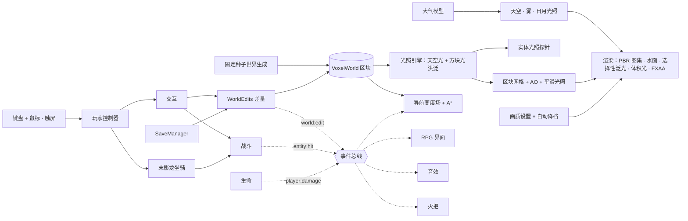

<p align="center">
  <a href="./README.md">English</a>&nbsp;&nbsp;·&nbsp;&nbsp;<strong>简体中文</strong>
</p>

<p align="center">
  <a href="https://jadeveil.xiaoa.name"></a>
</p>

<p align="center">
  一个用 three.js 从零写成的 Minecraft 渲染风格体素奇幻世界。它的第一座城 —— 翡翠之城，一座笼在雾里的朱墙金瓦、浮岛环绕的主城 —— 现已开放：扮演红兜帽的杰杰在城中探索，用中式建材盖房子，骑末影龙从城上飞过。
</p>

<p align="center">
  <a href="https://jadeveil.xiaoa.name"><strong>▶ 在浏览器里直接玩</strong></a>
  &nbsp;·&nbsp;
  <a href="#游玩与安装"><strong>安装为应用</strong></a>
</p>

<p align="center">
  <a href="#主城">主城</a>
  &nbsp;·&nbsp;
  <a href="#玩法系统">玩法系统</a>
  &nbsp;·&nbsp;
  <a href="#架构">架构</a>
  &nbsp;·&nbsp;
  <a href="#本地运行">本地运行</a>
  &nbsp;·&nbsp;
  <a href="#测试">测试</a>
  &nbsp;·&nbsp;
  <a href="#版权与致谢">版权与致谢</a>
</p>

<p align="center">
  <a href="https://jadeveil.xiaoa.name"></a>
  
  
  
  
  
  
  
</p>

<p align="center">
  <a href="https://jadeveil.xiaoa.name"></a>
</p>

---

## 主城

JADEVEIL 是一整个世界的名字，而不是一张地图。长远目标是一个《激战 2》规模的世界：许多地区、城市和族群，由同一套世界观串起来。它用 Minecraft 的外观来呈现：方块地形、像素贴图和 64 × 64 的角色皮肤。玩法上它是一款叙事驱动的单机 RPG，而不是沙盒。

目前开放的只有一处：**翡翠之城**，这个世界的第一座主城。它的美术方向参考了《魔兽世界》的潘达利亚：朱红殿宇、鎏金琉璃瓦、灯笼长街、层层园林，以及在雾中漂浮的岛屿。这个仓库里的一切都是之后整个世界的地基：渲染、光照、物理、居民、战斗、存档，以及在所有设备上都好用的界面。

一切都是程序化生成、离线可玩的。200 多张方块贴图全部由代码逐像素绘制，世界由固定种子确定性生成，游戏直接以 ES 模块运行：没有打包器，没有构建步骤，运行时也不依赖任何网络请求。

<p align="center">
  
  <br><sub>末影龙坐骑：按原版模型逐部件重建，黄昏时在主城上空喷吐龙息。</sub>
</p>

<table>
  <tr>
    <td width="50%" align="center"><br><sub>杰杰：MC 标准皮肤布局、双层兜帽、发光的玉剑</sub></td>
    <td width="50%" align="center"><br><sub>灯笼长街：140 位居民行走在考虑身体尺寸的导航网格上</sub></td>
  </tr>
  <tr>
    <td align="center"><br><sub>夜晚的训练场：火把、训练假人与实时血条</sub></td>
    <td align="center"><br><sub>27 种中式建材，每种 6 张随机变体</sub></td>
  </tr>
  <tr>
    <td align="center"><br><sub>背包与建材目录：Minecraft 式的堆叠操作</sub></td>
    <td align="center"><br><sub>标题页：继续游戏、新游戏或读取存档文件</sub></td>
  </tr>
</table>

## 游玩与安装

打开 **[jadeveil.xiaoa.name](https://jadeveil.xiaoa.name)** 就能直接玩。JADEVEIL 是一款渐进式 Web 应用（PWA），安装一次之后，它会在独立窗口中打开，可以从程序坞或主屏幕启动，离线也能玩。

| 平台 | 安装方式 |
|---|---|
| Chrome / Edge（电脑） | 点标题页或暂停菜单里的 **INSTALL APP**，或者点地址栏里的安装图标 |
| Android（Chrome） | 菜单里的 **INSTALL APP**，或 ⋮ →「安装应用」 |
| iPhone / iPad（Safari） | 分享 →「添加到主屏幕」（标题页会显示这条提示） |

在支持的浏览器上，进入游戏时默认全屏（可在 **SETTINGS → GRAPHICS** 里关闭）。全屏时轻按 `Esc` 只会打开暂停菜单，不会退出全屏。手机和平板横屏游玩；竖着拿手机时会出现「请横屏」提示，并自动暂停游戏。

安装时会预先缓存游戏外壳，各个模块、贴图和音效会在第一次游玩时进入缓存。之后断网也能完整启动。存档保存在浏览器里，每个域名各自独立；如果要在不同设备或域名之间转移进度，用暂停菜单里的 **EXPORT SAVE FILE** 和 **LOAD SAVE FILE**。

## 亮点

<table>
  <tr>
    <td width="50%" valign="top">
      <h3>还原的是末影龙本身</h3>
      <p>坐骑严格按原版 <code>EnderDragonModel</code> 搭建：部件尺寸、枢轴、256 × 256 box UV、两段式翅膀和原版扇翼曲线都一致。龙眼与龙息走选择性泛光。四个技能：龙息、末影火球、虚空冲刺、龙吼。</p>
    </td>
    <td width="50%" valign="top">
      <h3>居民不会穿模</h3>
      <p>居民在逐格高度场导航网格上行走，网格记录每格的头顶净空和身体半径。每一步位移都要按身体占地校验，所以居民不可能走进墙里、水里或悬在半空。测试会让 140 人连续跑 90 秒，全程检查这三项。</p>
    </td>
  </tr>
  <tr>
    <td valign="top">
      <h3>存档只有几 KB</h3>
      <p>世界由固定种子生成，存档只记录玩家改动过的方块，以「方块名 + 调色板」保存，再加上玩家、背包和时间。存档自动写入 IndexedDB，也可以导出、导入 <code>.jadeveil</code> 文件。</p>
    </td>
    <td valign="top">
      <h3>程序化像素美术</h3>
      <p>所有贴图都以 64 × 64 生成，并派生出法线和粗糙度贴图。建材按每块砖、每条木板单独随机，图集还会换种子重绘出多张变体，大面积的墙面也不会重复。</p>
    </td>
  </tr>
  <tr>
    <td valign="top">
      <h3>光只照到该照的地方</h3>
      <p>灯笼和火把不再使用实时点光源。天空光与方块光在体素世界里逐格扩散，每走一格衰减一级，与 Minecraft 的照明模型相同。墙能挡光，屋里和檐下逐格变暗；每个顶点取周围四格的平均值，明暗过渡平滑。编辑世界时增量重算，结果与整张图重算完全一致。玩家、居民和龙也采样同一份光照，进屋会变暗，站在灯笼下会被照亮。太阳阴影贴图按纹素对齐，走路时阴影边缘不再抖动。</p>
    </td>
    <td valign="top">
      <h3>真正的游戏循环</h3>
      <p>有血量、氧气、摔落伤害、自然回血和死亡。近战带冷却和下落暴击；挖下的方块会掉落，走过去就能捡起；火把可以插在地面或墙面，支撑方块被挖掉时会掉下来。蹲下时不会从边缘掉下去。所有系统都通过同一条事件总线连接。</p>
    </td>
  </tr>
  <tr>
    <td valign="top">
      <h3>天空是算出来的，不是画出来的</h3>
      <p>天空来自单次散射大气模型：瑞利散射、米氏散射，加上臭氧吸收。雾、环境光和阳光颜色都由同一个模型驱动，地平线和天空永远接得上。日落时从金色过渡到红色，再到紫色的余晖。天黑后月亮接替太阳成为投影光源。月相八天一个周期，明暗交界线是正确的；新月之夜，灯笼就是唯一的光。星空随夜晚缓缓转动。</p>
    </td>
    <td valign="top">
      <h3>高配满级，低配也流畅</h3>
      <p>画质有五档：AUTO、LOW、MED、HIGH、ULTRA。每一档都真正减少开销（分辨率、阴影、泛光、体积光、反射、视距、粒子），而不只是不显示。没有贡献的渲染遍每帧直接跳过。AUTO 按显卡和设备分级决定起点，高配台式机直接 ULTRA；只有帧率持续偏低时才降一档，并提示玩家在哪里调。卡顿过去后，连续 20 秒帧率有余量就会升回来，但不会超过设备分级给出的档位。在 Apple M3 Max 上，LOW 每帧 0.46 ms，ULTRA 每帧 5.65 ms。</p>
    </td>
  </tr>
  <tr>
    <td valign="top">
      <h3>为触屏设计，而不是将就</h3>
      <p>手机和平板上是浮动的模拟摇杆：轻推慢走，推到边缘疾跑。右半屏拖动转视角、轻点攻击，全程支持多指。跳跃、蹲下、下降和菜单都有独立按钮，并避开设备的安全区。小屏上界面仍保持足够大的点击区域。</p>
    </td>
    <td valign="top">
      <h3>真正的设置窗口</h3>
      <p>设置在居中的窗口里打开，分 GRAPHICS、CONTROLS、AUDIO 三页。每个按键都标明操作方式（HOLD 按住、PRESS 按下、CLICK 点击）；蹲下和疾跑可以分别设成按住或切换；RESTORE DEFAULTS 经确认后一键还原。光标是像素风的。任何窗口打开时鼠标都会释放，关闭后也不会卡在无法操作的状态。</p>
    </td>
  </tr>
  <tr>
    <td valign="top">
      <h3>两种玩法，技能靠练出来</h3>
      <p>默认是 ADVENTURE（冒险）：手里拿着翡翠剑，鼠标左键就是斩击。没有职业，没有技能点，也没有技能树。一开始就会几个实用技能（突进、旋风斩、愈合、闪避），用剑命中 20 次后学会「翡翠新月」。BUILD（建造）就是 Minecraft：挖、放、完整的快捷栏。按 <code>B</code> 切换。</p>
    </td>
    <td valign="top">
      <h3>会回应你的世界</h3>
      <p>水按 Minecraft 的方式分八级流动：挖开堤坝，池水就涌出来；切断水源，水流就会干涸。脚下的土没了，沙子会落下、花会掉落。末影龙的火球会炸出弹坑并溅出实体碎块，龙息会烧掉木头、树叶和竹子。地形破坏可以在设置里关闭。</p>
    </td>
  </tr>
  <tr>
    <td valign="top">
      <h3>修过的问题不会再回来</h3>
      <p>调度表规定每种游戏状态下哪些系统在跑：暂停时世界静止，死亡时不会自动存档。所有按键由同一个输入路由处理。每种移动方式声明自己的地形规则，所以飞行坐骑把水面当作地面。世界生成时每个建筑登记自己的占地；世界审计（<code>npm test</code>）检查建筑重叠、共面闪烁、悬空方块和走不到的站位。固定种子的长测让一个随机玩家跑 4200 帧，每一帧都检查八条不变量。</p>
    </td>
    <td valign="top">
      <h3>为拇指设计的技能盘</h3>
      <p>触屏上，技能围绕主攻击键排成一圈，并随情境切换：步行时是剑技，骑龙时是龙技，建造模式下是放置。技能盘按真实屏幕尺寸排布，按钮不会互相重叠，也不会压到小地图或超出屏幕；每个按钮都显示冷却和学习进度。</p>
    </td>
  </tr>
</table>

## 操作

**键盘与鼠标。**「按住」表示松开按键动作就停止；蹲下和疾跑可以在 **SETTINGS → CONTROLS** 里改成「切换」。

| 动作 | 按键 | 方式 |
|---|---|---|
| 移动 | `W` `A` `S` `D` | 按住 |
| 疾跑 | `Shift` | 按住（或切换） |
| 蹲下：走得慢，不会从边缘掉下去 | `C` | 按住（或切换） |
| 跳跃；按住游泳上浮 / 飞行上升 | `空格` | 按下 |
| 切换冒险 ↔ 建造 | `B` | 按下 |
| 冒险：翡翠斩 | 鼠标左键 · `1` | 点击 |
| 冒险：突进 · 旋风斩 · 新月 · 愈合 | `2` `3` `4` `5` | 按下 |
| 冒险：闪避 | `Q` | 按下 |
| 建造：攻击目标；没有目标时挖掉准星下的方块 | 鼠标左键 | 点击 |
| 建造：放置手持方块 / 在地面或墙面插火把 | 鼠标右键 | 点击 |
| 建造：选择快捷栏 | `1`–`9` · 鼠标滚轮 | 按下 |
| 背包与建材目录 | `E` | 按下 |
| 召唤 / 解散末影龙 | `F` | 按下 |
| 龙息（鼠标左键同样可以） | 骑乘时 `1` | 按住 |
| 火球 · 虚空冲刺 · 龙吼 | 骑乘时 `2` `3` `4` | 按下 |
| 飞行或游泳时下降 | `C` | 按住 |
| 视角：第一人称 → 第三人称 → 环绕 | `V` | 按下 |
| 设置窗口 | `O` | 按下 |
| 时间流速 · 小地图 · 隐藏界面 | `T` · `M` · `H` | 按下 |
| 调试信息（统计、时间、区块进度） | `F3` | 按下 |
| 暂停菜单：保存、导出、读取、设置、全屏、回到标题 | `Esc` | 按下 |

**触屏（手机与平板，横屏）。**

| 动作 | 操作 |
|---|---|
| 移动；推到边缘疾跑 | 左半屏任意位置按下拇指（浮动摇杆） |
| 转视角 | 右半屏拖动 |
| 攻击 / 挖方块 | 轻点右半屏 |
| 冒险 ↔ 建造 | **BUILD** / **FIGHT** |
| 主动作：斩击 · 放置 · 龙息 | 右下角的大按钮（按住） |
| 技能 | 主按钮周围的技能盘 |
| 跳跃 · 上浮 · 上升 | **JUMP**（按住） |
| 蹲下 / 站起 | **CROUCH** |
| 飞行或游泳时下降 | **DOWN**（按住） |
| 选择物品 | 点快捷栏格子 |
| 暂停 · 背包 · 末影龙 · 视角 | **MENU** · **BAG** · **DRAGON** · **VIEW** |
| 龙技能 | 骑龙时技能盘自动换成龙技能 |

## 玩法系统

| 系统 | 做了什么 | 源码 |
|---|---|---|
| 主角 | 杰杰，使用 Minecraft 1.8+ 的 64 × 64 皮肤布局（底层 + 外层）；第一人称手臂和手持物；游泳、骑乘、挥击姿态 | `src/player/skin.js`、`src/player/avatar.js` |
| 生命 | 20 点血；摔落伤害 = 下落格数 - 3；10 秒氧气；脱离伤害 6 秒后回血；死亡与重生 | `src/game/health.js` |
| 背包 | 36 格（快捷栏 + 背包）；拿起、拆半、Shift 快速转移；收录全部方块的建材目录 | `src/game/inventory.js`、`src/ui/inventoryUI.js` |
| 建造 | 挖方块弹出掉落物，靠近自动吸入背包；放置会消耗手持的那一组 | `src/player/interaction.js`、`src/game/drops.js` |
| 道具 | 木剑、石剑、玉剑（伤害、冷却、击退、暴击）；火把（火苗粒子，发出方块光） | `src/game/items.js`、`src/game/sprites.js`、`src/game/torches.js` |
| 战斗 | 可受伤实体注册表；球形、锥形、射线范围查询；持续伤害区；飘字伤害数字 | `src/game/combat.js`、`src/game/dummy.js` |
| 坐骑 | 末影龙模型、飞行手感、转向滚转、能量、四个技能、像素方块粒子特效 | `src/mount/`、`src/fx/fxParticles.js` |
| 居民 | 10 种职业共用一套图集皮肤和实例化骨架；兴趣点、聊天、打招呼、注视玩家、看见龙会惊呼 | `src/world/npc.js`、`src/world/navgrid.js` |
| 存档 | IndexedDB 自动存档；标题页继续游戏；导出和导入 `.jadeveil`；带版本号的迁移 | `src/game/save.js`、`src/game/worldEdits.js` |
| 界面 | 像素字体 UI 与像素光标；标题页和暂停菜单；分页设置窗口与还原默认；整齐对齐的底部状态栏；按视口自适应缩放（触屏有最小尺寸） | `src/ui/` |
| 光照 | 天空光 + 方块光逐格洪泛（每格 0–15）；顶点平滑光照；编辑时增量重算；实体光照探针 | `src/world/lighting.js`、`src/core/entityLight.js` |
| 昼夜 | 瑞利 / 米氏 / 臭氧大气模型，天空、雾和光照共用；太阳 → 月亮切换主光源；八天月相；转动的星空；暮光亮度适应 | `src/core/atmosphere.js`、`src/core/sky.js`、`src/core/daynight.js` |
| 画质 | 五档设置、设备分级、自动降档、按帧跳过渲染遍、粒子密度 | `src/core/quality.js`、`src/core/renderer.js` |
| 设备 | 带模拟摇杆和情境技能盘的触屏操作、竖屏提示、带键盘锁的全屏、防幽灵点击 | `src/ui/touchControls.js`、`src/ui/rotateGuard.js`、`src/ui/fullscreen.js` |
| 技能 | 无职业、用出来的剑技；冷却；突进与闪避的强制位移；冒险 / 建造两种模式 | `src/game/skills.js`、`src/ui/skillIcons.js` |
| 方块物理 | 八级流动的水、下落的沙子、需要支撑的植物；分批结算 | `src/world/blockPhysics.js` |
| 地形破坏 | 爆炸弹坑与实体碎块、燃烧、批量重算光照；可以关闭 | `src/game/destruction.js` |
| 框架 | 按游戏状态的系统调度表、统一输入路由、按移动方式的地形规则、世界生成占地登记 | `src/core/schedule.js`、`src/core/input.js`、`src/player/controller.js`、`src/world/generator.js` |

## 架构



系统之间通过 `src/game/events.js` 的 `领域:动作` 事件通信，而不是互相直接调用。新系统只需订阅它关心的事件，不用修改发出事件的代码。

### 每帧顺序

```text
昼夜（颜色由大气模型算出）→ 玩家物理 → 坐骑姿态与技能 → 化身姿态
→ 生命 · 战斗区域 · 掉落物 · 火把 · 自动存档
→ 区块流式加载与剔除（只因光照变化的重建分帧进行）→ 实体光照探针
→ 居民 → 粒子 → [视野里有水才渲染反射] → [太阳在屏幕内才渲染体积光遮罩]
→ [泛光合成] → 主合成 → 界面 · 触屏层 · 自动降档
```

### 光照

```text
light(x, y, z) = sky << 4 | block                       （各 0..15）
sky   ：穿过空气垂直向下保持 15；横向每格 -1；树叶 / 水衰减更多
block ：灯笼 15、火把 14；每格 -1；不透明方块挡光
顶点  ：角点相邻 4 格的平均值（与 AO 用同一组格子）
着色  ：albedo × mix(0.36, 1, sky^1.5)  +  albedo × 暖光 × block^1.35 × 昼夜强度
编辑  ：先「移除洪泛」清掉旧光，再从边界重新扩散，只重建光照有变化的区块
```

### 居民的移动保证

```text
supportHeight(x, z) = 身体占地下各采样点可站立面的最高值 H
bodyFits(x, z)      = 每个采样点都可走、比 H 低不超过 1 格，
                      且在 H 之上至少有 2 格净空
每一步位移           = bodyFits(候选位置) || 沿单轴滑行 || 原地不动
```

路径的每一条边都用同一个判定预先校验（按边缓存，世界改动时失效），所以 A* 永远不会规划出移动代码会拒绝执行的路线。

## 存档格式

```jsonc
{
  "game": "jadeveil",
  "version": 1,
  "savedAt": 1792240000000,
  "player": { "pos": [0.5, 35, 84.5], "yaw": 3.14, "pitch": -0.05, "mode": "first" },
  "health": { "hp": 20, "air": 10 },
  "inventory": { "selected": 0, "slots": [["sword_jade", 1], ["torch", 64], null] },
  "time": 420,
  "world": { "palette": ["jade_floor", "air"], "list": [2, 35, 82, 0] },
  "drops": [["block:oak_planks", 1, 3.5, 35.12, 81.5]]
}
```

## 目录结构

```text
index.html                  # 页面骨架、HUD 结构、import map → vendor/three、PWA 与分享卡 meta
manifest.webmanifest        # PWA 清单（图标、截图、全屏显示）
sw.js                       # Service Worker：网络优先，离线回退缓存
favicon.ico · favicon.svg   # 品牌图标，由 scripts/brand.mjs 生成
icons/ · pwa/               # 应用图标（普通 + 可裁切）与安装面板截图
og-image.png                # 1200 × 630 分享卡
serve.mjs                   # 零依赖的本地静态服务器
src/
├── main.js                 # 启动、状态机、系统组装、测试运行器入口
├── core/                   # 渲染器、大气、天空、昼夜、画质设置、实体光照、水面、粒子
├── world/                  # 体素存储、世界生成、光照引擎、网格、图集、贴图、导航、居民
├── player/                 # 控制器、化身（杰杰）、皮肤骨架、交互
├── game/                   # 事件、物品、背包、生命、战斗、技能、地形破坏、掉落、火把、存档
├── mount/                  # 末影龙模型与坐骑控制
├── fx/                     # 像素方块粒子池
├── audio/                  # 音效管理（CC0 / CC-BY 音效）
└── ui/                     # 像素字体与 UI 套件、HUD、菜单、设置、背包、触屏、全屏、界面缩放
tests/                      # 浏览器内测试套件（碰撞、浮岛、世界防护、水体、质量、RPG、居民、体验、世界、长测）
scripts/audit-world.mjs     # Node 里的世界审计（npm test）
vendor/three/               # 锁定版本的 three.js r186 核心与用到的 addons
audio/                      # 音效文件与 CREDITS.md
scripts/brand.mjs           # 一份 32 × 32 像素 logo → 全部图标、字标与分享卡
docs/                       # 美术方向、开发日志、部署说明、README 配图
```

## 本地运行

### 环境要求

- Node.js 18+（只用来提供静态文件）
- 支持 WebGL2 的现代 Chromium、Safari 或 Firefox

### 运行

```bash
git clone https://github.com/a-side-project/jadeveil.git
cd jadeveil
node serve.mjs 8123
```

打开 `http://127.0.0.1:8123/` 即可。不需要安装或构建任何东西：three.js 已随仓库提供，通过 import map 加载。只有部署工具需要 `npm install`。

## 测试

测试套件直接在运行中的页面里执行，作用于真实的世界、物理和各个系统，并且走的是玩家真实的操作路径：摔落是真的从高处掉下来，憋气是真的潜进水里，捡东西是真的挖下方块再走过去。每个套件都在隔离的测试状态下运行，结束后恢复游戏现场。

```js
__pandaria.runCollisionTests()           // 34  子步进 AABB、防隧穿、区块接缝、飞行
await __pandaria.runIslandAccessTests()  //  6  每座浮岛都能步行登上
__pandaria.runWorldGuardTests()          //  6  基岩、掉出世界恢复、安全出生点
__pandaria.runWaterTests()               //  5  浮力、游泳、水下视角
__pandaria.runQualityTests()             //  3  化身与放置回归
__pandaria.runRpgTests()                 // 13  生命、背包、掉落、建造、火把、近战、坐骑、存档
__pandaria.runNpcTests()                 //  4  140 人 × 90 秒：0 穿墙、0 入水、0 离网
await __pandaria.runUxTests()            // 14  墙挡光、增量重算 = 全量重算、阴影纹素对齐、画质档位、
                                         //     自动降档与回升、蹲在边缘不掉落、切换式疾跑、模拟摇杆、
                                         //     设置窗口不会让指针失控、还原默认
await __pandaria.runWorldTests()         // 14  水流扩散、溃坝、断源干涸、沙子下落、爆炸弹坑、
                                         //     燃烧、关闭地形破坏、剑技、学会技能、两种模式
await __pandaria.runSoakTests()          //  8  固定种子的随机玩家 × 4200 帧，每帧检查不变量：
                                         //     数值有限、不卡进方块、坐骑不入水、暂停时一切静止、
                                         //     生命值在范围内、居民不穿墙、没有报错
```

世界本身在 Node 里检查，不需要浏览器：`npm test`（或 `npm run audit`）生成世界并检查七条规则——建筑互相覆盖、植物长进建筑、城里有实心云、半透明方块共面、建筑悬空、宫墙是否围住全城、每个居民站位都走得到。

测试时可以在网址后加 `?quality=low|medium|high|ultra`、`?touch=1` 或 `?nosw`，分别强制画质档位、强制触屏模式、绕过 Service Worker。

## 部署

正式版是部署在 Vercel 上的静态站点，地址是 **[jadeveil.xiaoa.name](https://jadeveil.xiaoa.name)**。没有安装和构建步骤（`vercel.json` 把两者都声明为空操作）。Service Worker 以 `no-cache` 方式提供，更新能立刻到达玩家；安全响应头与其他 `xiaoa.name` 项目保持一致。品牌资产用 `node scripts/brand.mjs` 重新生成。

## 工程原则

- **沿玩家的真实路径验证。** 测试复现玩家的实际操作，而不是直接瞬移到答案。
- **断言行为，而不是边界。** 断言「站在地面上，y 恰好等于 126」，而不是「y 不低于 126」。
- **看实际画面。** 渲染改动在每种界面状态、多种窗口尺寸下对照截图核对，而不只是看报错数。
- **优先参考实现。** 选择性泛光按 three.js 官方示例做，末影龙按原版模型做，不靠阈值调参或「看起来差不多」。
- **系统之间用事件通信。** 生命、战斗、世界编辑发出事件；界面、音效、火把、导航订阅事件。
- **状态是数据，世界是函数。** 存档只保存状态，世界由种子重新生成。
- **零构建。** 纯 ES 模块、锁定版本的 three.js、import map。

## 路线图

- 更大的世界：翡翠之城之外的新地区与城市，骑龙往来
- 合成：背包内 2 × 2 合成格、合成台、配方书
- 怪物、AI 与掉落；更多武器，每种都有自己可以学会的技能
- 任务与居民对话；商人与经济系统
- 装备与护甲栏位

## 版权与致谢

本仓库包含为 JADEVEIL 编写的原创源码、程序化生成的贴图和文档。

- **杰杰（JJ）** 是 Maizen 的 Minecraft 动画系列中的角色，本项目中的形象是同人重制：皮肤由代码程序化绘制，不包含任何原始素材。
- **末影龙**以及 **Minecraft** 的整体视觉风格归 Mojang Studios / Microsoft 所有。龙的几何结构依据公开的模型布局知识重建，贴图由程序生成。
- 主城的美术方向参考了《魔兽世界》（Blizzard Entertainment）潘达利亚地区的公开概念图，出处列在 `docs/ART_DIRECTION.md`。仓库及其全部历史中不包含任何暴雪的素材或音频。
- 音效来自 Kenney.nl（CC0）和 Blender Foundation（CC-BY 3.0），详见 [`audio/CREDITS.md`](audio/CREDITS.md)。
- three.js 版权归其作者，以 MIT 许可证分发（见 `vendor/three/LICENSE`）。

JADEVEIL 是一个独立的非商业项目，与 Mojang、Microsoft、Maizen、Blizzard Entertainment 均无关联，也未获得其认可。原创代码目前不授予任何许可证，作者保留全部权利。详见 [`THIRD_PARTY_NOTICES.md`](THIRD_PARTY_NOTICES.md)。

---

<p align="center">
  <strong>JADEVEIL —— 雾与玉的体素之境。</strong>
  <br><sub>一个更大世界的第一座城。一位红兜帽的主角。一条非常大的龙。</sub>
</p>
